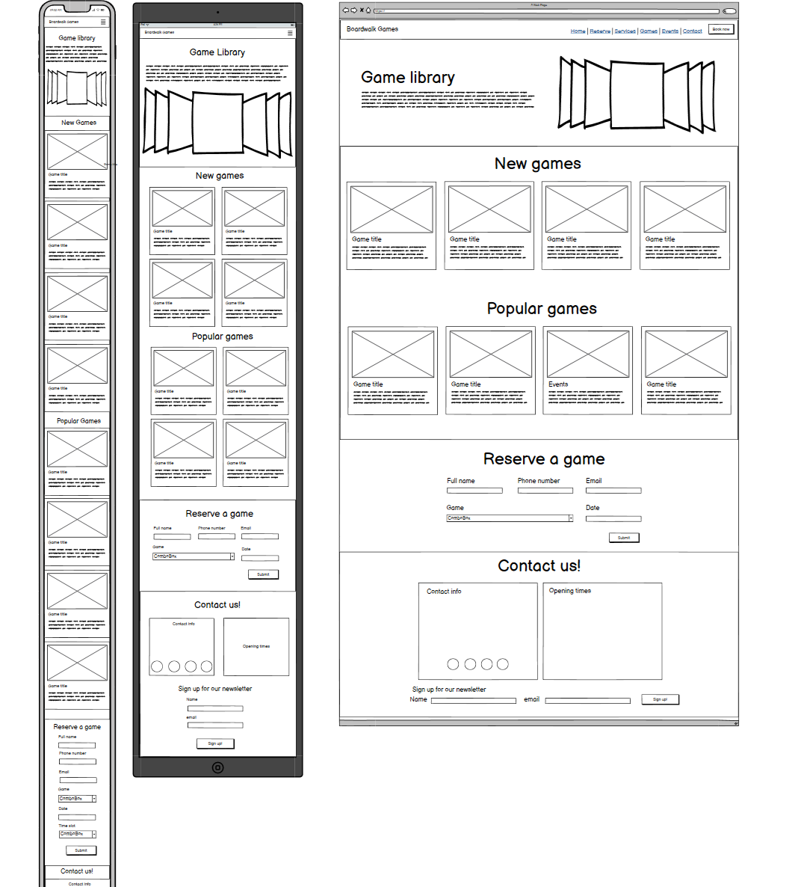

# Boardwalk Games — Project Planning

## Project Overview

Boardwalk Games is a board game shop and café that provides customers with opportunities to discover, play and enjoy tabletop games.

This website is being developed as part of the Code Institute Level 5 Web Development guided practice project.

## Business Goals

1. Increase customer visits to the physical shop and café.
2. Showcase the board games, events and activities available.
3. Help potential customers find opening hours, location and contact information.
4. Encourage customers to make booking enquiries.
5. Promote customer engagement through additional features such as testimonials and newsletter sign-ups.

## Target Audience

The website is designed for:

- Board game enthusiasts looking for new games to discover.
- Families and groups interested in playing games together.
- New customers exploring the shop and café.
- Customers interested in events and activities.

## Additional Game Library Challenge

The client has requested two additional features:

1. A Game Library page displaying four new games and four old favourites.
2. A form allowing customers to request a game reservation for a specific date.

These features will be planned using user stories, acceptance criteria, responsive wireframes and the existing website design.

## Visual Design

### Colour Palette

The website uses the colour palette introduced in the Code Institute Boardwalk Games design lesson.

| Colour | Hex Code |
|---|---|
| Beaver | #AA9581 |
| Blue | #416A8E |
| Light Blue | #7A9FC2 |
| White | #FFFFFF |

### Colour Choices

- Blue will be used for key navigation and design elements.
- Light blue will provide contrast between sections.
- Beaver will be used as an accent colour.
- White will provide clean backgrounds and improve readability.

The colours will be checked using the WebAIM Contrast Checker to ensure text remains accessible.

### Typography

The website will use consistent typography across all pages.

- Headings will be clear and visually distinct.
- Body text will be readable and appropriately sized.
- Font choices will follow the Code Institute design guidance.
- Bootstrap typography utilities will help maintain consistency.
- Text contrast and readability will be checked during testing.

### Responsive Design

The website will use Bootstrap's responsive grid system to adapt to different screen sizes.

**Mobile:**
- Game cards will appear in one column.
- Navigation will collapse into a mobile menu.
- Form fields will stack vertically.

**Tablet:**
- Game cards will appear in two columns.
- Content spacing will adjust to the available width.
- Forms will remain easy to use.

**Desktop:**
- Game cards will appear in four columns.
- Navigation links will display horizontally.
- Content will use Bootstrap containers to maintain readable widths.

### Consistent Page Elements

The following elements will be reused across the website:

1. Header and navigation.
2. Website colour palette and typography.
3. Bootstrap cards and buttons.
4. Footer with relevant business information.

## Game Library Wireframes

The Game Library page will follow the responsive wireframes supplied by Code Institute as part of the Boardwalk Games guided project.

The wireframes illustrate three screen sizes:

- Mobile: Game cards displayed in one column.
- Tablet: Game cards displayed in two columns.
- Desktop: Game cards displayed in four columns.

The page includes sections for new games, popular games, a game reservation form and contact information.

The design will reuse the website's navigation, footer, typography and colour palette to maintain consistency.

### Wireframe Reference

**Source:** Code Institute, Boardwalk Games, Game Library planning challenge.
